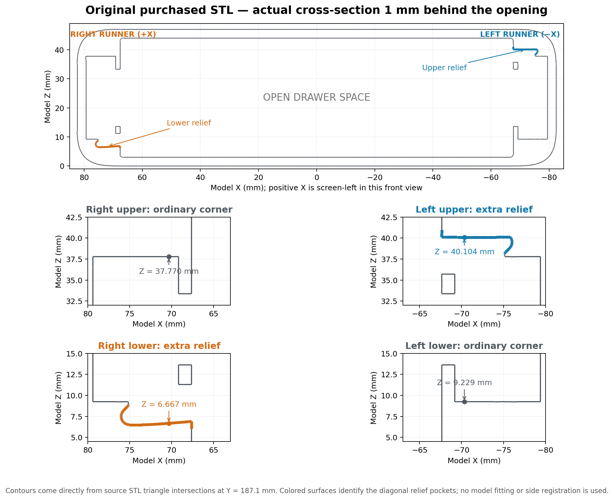

# Vault CAD

The size configurator at **https://vaultgen.erik.cl** generates matching modules,
boxes, facades, geared rails, runner guides and runner slides. Choose S, M or L,
depth 3–7, and 1F or 2F;
XL and taller configurations are excluded from the generator. Build a single
part or a complete set, inspect the actual print-oriented STL in 3D, and download
checked STL/STEP files or the whole set as a ZIP. Existing host sign-in protects
the application.

Run locally with `python -m vault.web` (loopback port 3941). See
[deployment](deploy/README.md) and [generator behavior](docs/generator.md).

The viewer catalog is declared in `partcad.json`, with explicit build bindings in
`cad-builds.json`. Generated files under `out/` are optional previews and history;
they do not define catalog membership. See [the catalog format](../../cad-tooling/docs/catalogs.md).

Editable build123d drawer modules reconstructed from purchased Vault STLs.
S4 Module 1F is the primary reference. Branding, decorative bottom ovals,
“align to connect” text and arrow, the large S4 marking, and the transverse
alignment groove are omitted. Runners, stopper slots, mounting bores, stacking
connectors, tracks, and drawer retention features remain.

Construction uses native curves, extrusions, fillets, chamfers, and short lofts.
It does not load an STL, BREP, or measured profile table. Purchased files in
`original_files/` remain local and are excluded from Git. They are needed only
for reference measurements and comparison validation, not model construction.

## Build

Enter the pinned development environment:

```bash
nix develop
# On a fresh checkout, run just setup once.
python -m vault build
python -m vault validate
python -m unittest discover -s tests -v
```

Other sizes reuse the same feature definitions:

```bash
python -m vault build --depth-units 3 --height-units 2
python -m vault build --family M --depth-units 5
python -m vault build --family L --height-units 2
python -m vault build --part box --family L --depth-units 7 --height-units 2
python -m vault build --part facade --family M --height-units 2
python -m vault build --part rails --family L
python -m vault build --part runner_guides --depth-units 4
python -m vault build --part runner_slides --depth-units 7
```

All sizes use the shared [build storage library](../../cad-tooling/docs/builds.md).
Successful builds are preserved in `out/builds/<build-id>/`, with Git provenance,
source snapshots, checksums, and `manifest.json`. `out/latest/<size>` selects the
newest build for each size; `out/latest-successful` selects the latest overall.
`--output PATH` chooses a different storage root. The viewer shows builds under
expandable commit messages; builds without Git provenance remain unlinked.
`render` and `validate` select the latest build for the requested size and write
new reports under `out/reviews/<build-id>/`. Legacy output directories remain
readable. Full `validate` currently compares S4 1F against its registered source;
other sizes need separate source checks.

Dependencies are pinned in `pyproject.toml` and `uv.lock`. The Nix workflow is
`nix develop`, `just setup`, `just build`. Builds and storage tests have also
been verified with this pinned Nix environment. Entering the shell does not
install dependencies.

## Size and feature definitions

| File | Responsibility |
| --- | --- |
| `src/vault/spec.py` | Family widths, connector bank positions, depth and tier counts. |
| `src/vault/model.py` | Assembly; require one valid solid with one boundary shell. |
| `src/vault/envelope.py` | Smooth sleeve corners and mirrored outside ears. |
| `src/vault/shell.py` | Cavity, repeated runners, bores, slots, catches, and mouth recesses. |
| `src/vault/connectors.py` | Reusable stacking features, dimensions, and placements. |
| `src/vault/mating_features.py` | Dovetail, rail, and shallow-track constructors. |
| `src/vault/alignment_features.py` | Alignment tabs and locking bridge. |
| `src/vault/hook_features.py` | Outer hook and its compact entry blend. |
| `src/vault/reference.py` | Source registration and comparison regions. |
| `src/vault/validation.py` | Surface checks, mechanical regions, and cleanup probes. |

Dimensions are millimeters. Model X is width, Y is travel from the closed back
toward the opening, and Z is height. Size changes move or repeat mating
features instead of stretching their cross-sections:

- Depth is `42 * depth_units + 20.1`.
- Outside skin height is `48 * height_units - 1`; runners repeat every 48 mm.
- Widths: S 164.8, M 254.0, L 329.6, XL 418.8.
- S and M have one central connector bank. L has banks centered at X = −82.4
  and +82.4. XL has banks at −82.4 and +127.0.
- Front connectors/catches follow the opening; rear features follow the back.
  The side stopper follows `depth / 2 + 28.50005`.

The closed rear wall is 0.9 mm thick for three 0.3 mm layers when printed with
the back on the bed. This intentionally differs from the 2 mm reference wall.

Supplied drawer references cover depth units 3–7 and heights 1F, 2F, 4F
(XL: 1F only). Other generated depths/tier counts are extensions. This
constructor does not reproduce the separate sustainer, lid, or divider
products. Measurement evidence is in `research/size_catalog.json`,
`research/depth_connector_sections.json`, and `research/shell_depth_anchors.json`.

For example, changing bore clearance does not move its axis or alter box size:

```python
from dataclasses import replace
from vault.model import build_module
from vault.shell import ShellDimensions
from vault.spec import ModuleSpec

module = build_module(
    spec=ModuleSpec("S", depth_units=3, height_units=2),
    shell_dimensions=replace(ShellDimensions(), bore_radius=1.9),
)
```

Connector dimension sets are grouped in `ConnectorParameters`. Use
`dataclasses.replace` on the appropriate nested dimension set to edit a shared
feature. Construction and left/right/front/back placement are separate.
Fit dimensions remain nominal for PLA; no untested shrinkage correction is
applied. Physical fit still needs checking with a particular printer and PLA.

The superseded dense section tables are archived under
`research/legacy_profiles/`; none is an input to the current constructors.

## Symmetry

The common sleeve corners and paired connectors share definitions. The source
is not entirely mirror-symmetric:

- The assembled runner mouths have a lower recess at negative X and an upper
  recess at positive X, matching the box's external gear exits. Their entry
  blends retain the original small difference.
- Lower closed-end dovetails have a small notch-position difference.
- The original lower-left outside corner has a localized ~0.2 mm bulge. The
  clean symmetric envelope omits that non-mating irregularity.



This historical triangle cross-section is 1 mm behind the opening, generated by
`research/mouth_pocket_section.py`. Its source registration swaps Y and Z without
negating X, which reflects the module and reverses the mouth pockets relative
to the box. The corrected pockets use the proper rotation, with X also negated.
`python tools/check_runner_interfaces.py` checks the corrected assembly against
the original parts; its evidence is in `research/runner_interfaces.json`.

Both mouth ledges include a **0.6 mm breakaway web**, rooted in the pocket's
rear wall. Two **0.7 mm contacts** cross a **0.3 mm gap** beneath each ledge,
supporting the small bridge at the runner-wall junction as printing grows in
positive Y. Remove these webs through the open mouths before fitting the rails.
Set `ShellDimensions(pocket_support_thickness=0)` to inspect the finished
interface without sacrificial material.

## STEP solids and review accuracy

Each build publishes `<size>.step` in model coordinates and
`<size>_print.step` with the closed back on the bed, plus native BREP,
`build.json`, the shared `manifest.json`, cyclone-style `viewer.json`, and
rendered `review/` images, and `stl/<module>.stl` for printing. The STL uses
the recorded print orientation and is validated as a closed, consistently oriented
mesh with positive volume. Its checksum is recorded in the immutable build manifest
and the viewer offers it under **Download STL**.

Both STEP exports are imported again before publishing. Like cyclone, the
round-trip checks require a valid solid and bounding-box error below 1e-4 mm.
Vault also requires one boundary shell. Its relative volume limit is 1e-5
(0.001%): the trimmed Vault surfaces show about 5.4e-6 drift after STEP
import across precision settings, exceeding cyclone’s 1e-7 limit.
Failed exports do not advance the latest-build pointers.

Rendering and reference comparisons tessellate the saved model-coordinate
STEP internally with absolute 0.05 mm chord and 0.5 radian angular settings,
with surface deflection control enabled. Temporary mesh interchange files
are removed after loading. This review mesh must be watertight, consistently
oriented, and agree with CAD volume within 0.1%. Cleanup removes only exact
collapsed/duplicate triangles or isolated defects within 0.005 mm without
moving vertices. STEP preserves native curves independently of review density.
Legacy STL builds remain readable by review commands.

## Validation

Comparison uses deterministic area samples plus vertices in both directions,
with exact point-to-triangle distances. It is a sampled comparison, not a proof
of maximum error at every point.

Default limits are 0.25 mm for retained surfaces, including the explicitly
simplified outside bulge/corner transitions, and 0.1 mm for mechanical regions:
connectors/tracks, cavity, runners, mouth recesses, bores, stopper slots,
catches, and rear reliefs. These stricter checks do not exclude anything from
the full comparison. Only requested decoration/groove removals are excluded
from source matching. Separate probes verify their flat replacements to 0.01 mm.

```bash
python -m vault validate --samples 100000 --tolerance 0.25 --mating-tolerance 0.1
python tools/plot_comparison.py
```

Results and worst points go to `comparison.json`; sampled points/distances go
to `comparison.npz`. Rebuilding invalidates old comparisons. Research reports
identify checked source/artifacts by hashes. `initial_export_validation.json`
belongs to the superseded detailed model.

The full module comparison retains its historical reflected source registration.
It therefore reports the corrected mouth handedness and added sacrificial pocket
supports as differences. Use the runner-interface checker above for the corrected
mouths; the historical full comparison is not an acceptance test for these edits.

## S1F facade and matching shadow line

`python -m vault build --part facade` builds the native S1F drawer facade
from `S1F (Turn On Supports).stl` measurements. `python -m vault build`
builds the corresponding S4 Module 1F. Both use the usual immutable build
storage and appear in the existing Vault viewer. The latest files are
`out/latest/s1f_facade/s1f_facade.step` and
`out/latest/s4_module_1f/s4_module_1f.step`.

The facade constructor is `src/vault/facade.py`; it uses native lofts, arcs,
extrusions and booleans, without loading the source mesh. It retains the
164.8 × 47 × 10 mm envelope, rear pockets, flat-sided screw bosses at
X=±51.45 / Z=23.5, 4.4 mm screw clearances, 10 mm counterbores, shaped finger
opening and shallow front-side recess. Curved blends are reconstructed
approximations. Small molded branding and front indexing marks are omitted,
consistent with the project's unbranded models. Run
`python tools/measure_facade.py` for a sampled, bidirectional source comparison;
its report includes the intended changes rather than hiding them. A successful
CAD export establishes solid validity, not exact source equivalence.

`ShadowGap` in `src/vault/shadow_gap.py` defines a **0.5 mm axial depth and
1 mm peripheral width on each mating face**. Together they form a 1 mm axial
shadow line, while the inner seating lands retain the original face positions.
The facade's rear seating plane is Y=0 and its front is Y=10. For a closed
assembly, translate it by (0, 188.1, 0) beside the S4 module. The module and facade rebates follow the selected width and height.
Passing `shadow_gap=None` to `build_module` or `gap=None` to `build_facade`
builds an unrecessed part. Gap tests probe both rebates, preserved lands and
screw clearances. Physical fit has not been tested.

The facade's curved surfaces can require finer mesh resolution: tessellation
now retries at 0.01 mm if the default 0.05 mm mesh exceeds the existing 0.1%
CAD-volume tolerance. STEP remains independent of the mesh resolution.

## S4 Box 1F

`python -m vault build --part box` builds the native drawer tray and publishes
`out/latest/s4_box_1f/`, including STEP, BREP, print STL, and review images.
The existing catalog entry is **S4 Box 1F**, bound to the `vault-box` adapter.
The CLI and generator also support S/M/L boxes and facades at 1F or 2F.
Shared dimensions and screw centers live in `src/vault/drawer.py`; runner
profiles repeat by tier, while the lock stays on the bottom tier. `python -m vault render --part box` renders its latest build.

`src/vault/box.py` constructs the 134.2 × 185.8 × 37.5 mm tray with a 0.8 mm
floor, a 1 mm reinforcing fillet at the interior floor-to-wall junction, a
rounded cavity, side runner channels and strips, a solid rear wall, and front
attachment lands with 3.6 mm screw holes. The front seating plane is
Y=188.1; screw centers are X=±51.45, Z=23.5, matching the positioned S1F
facade. Print exports place the closed bottom on Z=0.
The interior is widened to leave 1.3 mm behind both runner channels for two
perimeters with a 0.6 mm nozzle. Exterior dimensions and the front screw
attachment wall are retained.

The front attachment pockets open through the outside wall at negative X/lower
and positive X/upper, matching the module's handed gear mates. The exits retain
the original rounded outer lips and front rim; the upper exit also includes
the raised round-ended roof clearance shown in the source model. Both box
variants use these same passages.

The exterior front corners are square in plan, as in the original box. This
preserves the side walls and front rims around the two closed attachment
pockets; the rear exterior corners remain rounded.
The taller upper-left closed pocket has a sloped outer roof corner that keeps
a 0.71 mm wall beneath the exterior chamfer, closing the small roof breakthrough.

All four front gear passages have **R0.8 mm longitudinal inside corners** at
their floors and roofs. These shorten the bridge span during bottom-down
printing. The raised upper flange clearance keeps its original shape. `build_box(gear_corner_radius=0)`
is available for comparison with the earlier sharp passages.

Both runner channels include 0.5 mm removable support sheets with 0.7 mm teeth
and 0.3 mm additional clearance on each upper/lower flank, with their original
depth retained. `build_box(runner_clearance=0)` restores nominal flank spacing.
The central lock opening extends back to the original beveled floor edge
(Y=177.1 at the underside), providing clearance for lock rotation.
The support teeth are
spaced about 9.1 mm apart along their upper and lower edges. Remove these
sacrificial supports after printing. The two rear circular holes and central oval opening are omitted,
along with the oval's support panel, leaving a continuous rear wall. Source measurements and the
regularized native dimensions are recorded in `research/box_supports.json`.

This is a simplified reconstruction: small blends, regularized support teeth,
and front attachment recesses differ from the purchased mesh. Branding is
omitted. These differences are not validated as mechanically equivalent,
and physical fit remains untested.
`python tools/measure_box.py` writes a deterministic, bidirectional comparison
with no exclusions to `research/box_comparison.json`, including source and
model hashes. Solid/export checks do not establish source equivalence; the
module's full `validate` command does not apply to this tray.

## S geared locking rails

`python -m vault build --part rails` publishes **S Geared Rails** in the
catalog. The set contains separate plain lower and retained upper rails, each
with its own checked STEP and print STL under `out/latest/s_geared_rails/`.
The assembly STEP preserves both named components. Print one of each flat on
its broad face, with the teeth in the bed plane.

`src/vault/geared_rails.py` reconstructs `S Rails.stl` with native curves and
editable dimensions: nominal 121.054 mm length, 4.8 mm body width, 3.8 mm
thickness, 0.8 mm bevels, rounded tooth roots, tapered tail and the upper rail's
retaining rib. It preserves the measured tooth spacing and three narrower
valleys. The source mesh is used only by measurement tools. A complete,
bidirectional sampled comparison found a maximum deviation of 0.029 mm;
`python tools/check_geared_rails_reference.py` reproduces the report in
`research/geared_rails_reference.json`.

The rails install laterally into the box before the drawer enters the module.
`python tools/check_geared_rails.py` checks their insertion and operating
positions against the box and module, with the module's sacrificial mouth
supports removed. Conservative native swept solids cover the complete 134 mm
sideways insertion and 0–20 mm opposed locking travel. Their minimum clearance
is **0.197 mm in either box variant** and **0.184 mm in the module** (rounded;
the latter is a conservative lower bound). Actual extended rails have 0.316 mm
module clearance; 21 mm travel reaches the stop. The report and two positioned
STEP review assemblies are under `out/reviews/geared-rail-fit/`.
These geometry checks do not establish physical printed fit or operation of
the separate pinion/locking mechanism.

The experimental printed screw joint, matching box and facade, and spring-tooth
fit coupons are preserved on branch `codex/printed-screw-joint`.

M and L rails are also available through `--family M` / `--family L`. Their
measured lengths are 165.654 and 203.454 mm; they retain the original 20 teeth
and add a straight shank before the tail instead of stretching the mechanism.

## Runner guides and slides

The generator offers **Runner guides** and **Runner slides** individually and
includes both in a complete set. Their size follows the selected depth, from
X3 through X7; S/M/L family and 1F/2F height do not change these parts. Use the
guide and slide files with the same depth as the module and box.

The CLI selectors are `--part runner_guides` and `--part runner_slides`, with
`--depth-units 3` through `7`. Each build provides its components as separate
print-oriented STL and STEP files, also available in the web preview and ZIP.
Each runner build contains a left/right pair. Use one guide pair and one slide
pair per populated runner tier; reprint these files for additional tiers.
Check the first printed assembly on the intended printer before making more.
