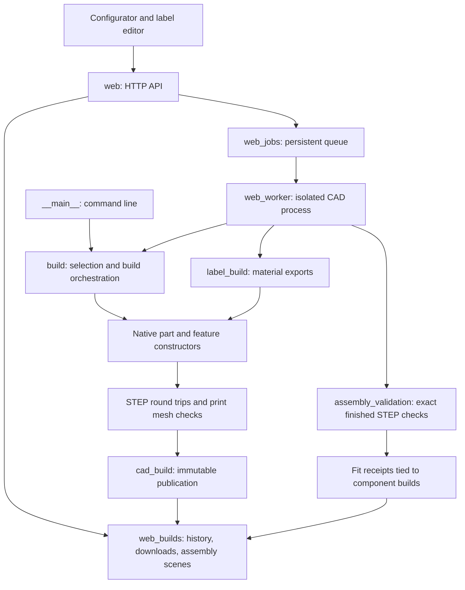

# Vault architecture

Vault is a native build123d CAD library with a command-line builder and two
browser workflows: the drawer configurator and the multicolor label editor.
Both publish through the same checked, immutable build storage. The separate
CAD catalog/viewer and the shared storage implementation live in
`../../cad-tooling/`.

## Responsibilities and boundaries

| Layer | Main modules | Responsibility |
| --- | --- | --- |
| Dimensions and requests | `spec.py`, `drawer.py`, `generator.py`, `label_config.py` | Shared dimensions, drawer layout, bounded requests, browser catalogs, label text layout. Request validation does not load the CAD kernel. |
| Module construction | `model.py`, `envelope.py`, `shell.py`, `connectors.py` | Compose the sleeve, cavity, runners, connectors, supports and optional wall patterns. |
| Shared features | `mating_features.py`, `alignment_features.py`, `hook_features.py`, `shadow_gap.py`, `wall_patterns.py` | Native mating profiles, feature dimensions and placement rules. |
| Other parts | `box.py`, `facade.py`, `gridfinity.py`, `box_wall_patterns.py`, runner/rail, key, accessory and label modules | Construct each part from native geometry; preserve its own dimensional and print-orientation contract. |
| Assembly | `assembly.py`, `assembly_validation.py` | Authoritative instance transforms, support-free components, rigid-transform checks, seated intersections and mating checks. |
| Build orchestration | `build.py`, `key_build.py`, `label_build.py` | Select part specifications and coordinate construction, export, validation and publication. `__main__.py` handles CLI arguments and commands. |
| Export and rendering | `exports.py`, `tessellation.py`, `mesh_cleanup.py`, `render.py`, `native_renderer.py` | Check STEP round trips, produce watertight print meshes and review images. The native rasterizer has a Python fallback. |
| Shared storage adapter | `_build.py`, `project.py` | Load the sibling `cad_build` package and identify the project root without importing research or CAD dependencies. |
| Web transport | `web.py` | Loopback HTTP, same-origin JSON submission, bounded requests, local static files and response streaming. |
| Job lifecycle | `web_jobs.py`, `web_worker.py` | Persist jobs, limit and deduplicate the queue, run one isolated CAD subprocess, retain partial success, check cache provenance and produce fit receipts. |
| Build access | `web_builds.py` | Describe saved builds, resolve matching assembly assets, check download hashes and compose printable ZIPs. |
| Browser | `static/app.js`, `static/labels.js`, `static/client.js`, `static/stl-viewer.js` | Page-specific selection/editing state, shared API/download behavior and shared local STL rendering. No browser package or CDN dependency. |
| Research | `reference.py`, `validation.py`, `research/`, measurement/check tools | Compare native parts with local reference evidence. Purchased meshes and measured profiles are never constructor inputs or public downloads. |

## Build and request flow

1. `Configuration` or `LabelConfiguration` validates a browser request. The
   drawer generator supports S/M/L, depths 3–7 and heights 1F/2F. Broader native
   research specifications do not expand that web contract.
2. `Jobs` persists and queues the request. `web_worker` resolves part specs via
   `build.select_spec`, reusing a cached build only when its checksums, source
   digest and clean Git provenance agree.
3. Constructors produce native geometry. Export code checks solids, STEP
   round trips and watertight print meshes before `cad_build` publishes a build
   and updates its latest pointer. A source change during construction prevents
   publication.
4. A complete-set worker imports the exact finished STEP components, applies
   the recorded assembly transforms and validates their seated pose. Its fit
   receipt names the exact component build IDs and validator signature.
5. `BuildFiles` serves only allowed, checksummed artifacts. Print ZIPs omit
   source snapshots and preview geometry. Printable parts retain sacrificial
   supports; assembly previews omit them.

Runtime jobs and fit receipts live in `out/web/`. Successful artifacts in
`out/builds/` are immutable; failures preserve earlier builds. Catalog membership
comes from `partcad.json` and `cad-builds.json`, independently of saved files.
The historical `vault.__main__.build_preview` catalog entry remains available;
new Python callers should import reusable build functions from `vault.build`.

## Testing and maintenance

The suite has three complementary kinds of evidence: inexpensive configuration
and lifecycle tests; native geometry/interface probes; and export/assembly
checks. Browser fixtures cover selection, job recovery, errors and downloads
without submitting CAD jobs. Live browser checks additionally exercise the
running HTTP service and saved builds. Commands and environment requirements are
in [the README](../README.md), [generator behavior](generator.md) and
[deployment](../deploy/README.md).

The audit separated reusable builds from the CLI, split HTTP transport from
jobs and build access, removed production path imports from reference code,
and shared the two editors' HTTP/download helpers. Repeated worker assertions
now share a helper. Thickness probes reuse existing native fixtures instead of
building four duplicate solids; pure build-history tests no longer start HTTP
servers. Gridfinity audit fixtures retain reports and labels instead of unused
native solids, and socket-only checks run independently of whole-drawer builds.

Keep feature-specific geometry components and page state distinct. Small
geometry helpers with different tolerances or handedness are not automatically
interchangeable. STEP validation has related implementations for single solids,
named assemblies and disconnected label materials; any future consolidation
must preserve those contracts and be checked with fresh exports.

CAD and export validity do not establish physical printed fit. Source comparisons
are sampled; the historical full `validate` command is specific to S4/1F.
Assembly checks certify a seated pose and exclude insertion motion, accessory
installation and loaded behavior. Existing immutable receipts describe their
recorded builds, not subsequently edited source.
